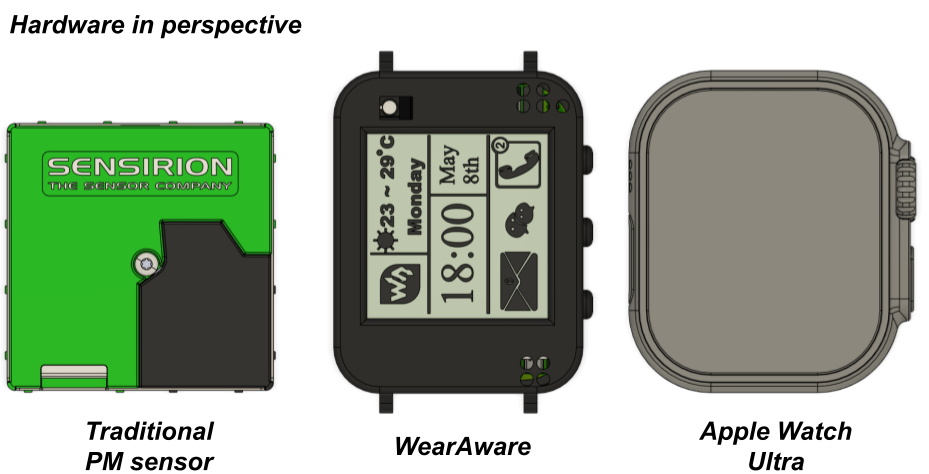

# WearAware

WearAware is an open-source wearable air-quality monitoring device designed to provide compact, low-power environmental sensing in a smartwatch-sized form factor.

The device is based on the ESP32-S3 and integrates multiple environmental sensors to measure particulate matter, CO₂, temperature, humidity, and pressure. Measurements are transmitted to a smartphone over Bluetooth Low Energy (BLE), while the integrated e-paper display shows the device status (Bluetooth off, pairing, connected).



## Hardware overview

WearAware combines the following main components:

- ESP32-S3 microcontroller
- Bosch BMV080 particulate matter sensor
- Bosch BME690 environmental sensor
- Sensirion STCC4 CO₂ sensor
- Sensirion SHT45 temperature and humidity sensor (used by the STCC4 for compensation)
- RV-3028-C7 real-time clock (RTC)
- MAX17048 battery fuel gauge
- E-paper display
- USB-C interface
- Three physical buttons (B1, B2, B3)

The main PCB components and their locations are shown below.


## Firmware

The firmware is developed using [PlatformIO](https://platformio.org/) and contains all files required to compile, upload, and run the current WearAware firmware.

The current implementation focuses on keeping the code simple and easy to understand, while providing the core functionality required to operate the hardware. This includes:

- Sensor initialization and data acquisition
- Power management and sensor duty cycling
- Bluetooth Low Energy communication
- Battery monitoring
- E-paper status display control
- Low-power operation using the ESP32-S3 power-management features (light sleep between measurement cycles, deep sleep when Bluetooth is off)

The firmware is intended to provide a clear starting point for understanding the hardware and for developing more advanced applications based on the WearAware platform.

## Getting started

1. Install [Visual Studio Code](https://code.visualstudio.com/).
2. Install the PlatformIO extension.
3. Clone this repository.
4. Connect the WearAware device through USB-C.
5. **Set the RTC** (first use, or after the battery was disconnected): open `tools/rtc_set` in PlatformIO, run `pio run -t upload -t monitor`, and enter the date and time when asked.
6. **Commission the STCC4 CO₂ sensor** (first use): open `tools/stcc4_commissioning`, run `pio run -t upload -t monitor`, and let it run in continuous mode for at least 1 h (preferably 12 h), then place the device in fresh air.
7. Open the main project directory in PlatformIO.
8. Download the **Bosch BMV080 SDK v11.2.0** from
   https://www.bosch-sensortec.com/en/software-tools/software/previous-sdk-bmv-080-versions/
   and accept Bosch's license terms. Build the project once so PlatformIO downloads the SparkFun library
   (the build will fail at this point), then copy these SDK files for the ESP32-S3 into
   `.pio/libdeps/esp32s3/SparkFun BMV080 Arduino Library/src/esp32s3/`:
   `lib_bmv080.a`, `lib_postProcessor.a`, `bmv080.h`, `bmv080_defs.h`
   (see the SparkFun library README for the exact source folder inside the SDK).
9. Build and upload the WearAware firmware.
10. Install the Android logger app (see below), press **B1** on the device to start BLE advertising, and connect from the phone.

## Using the device

| Screen | Meaning | Buttons |
|---|---|---|
| Bluetooth off | ESP32-S3 in deep sleep, sensors off | **B1**: start Bluetooth (advertising) |
| Pairing | Advertising as `ESP32_S3_LowPower`, waiting for the phone | **B1**: Bluetooth off |
| Connected | One measurement per minute is sent to the phone | **B1**: ask to disconnect |
| Disconnect phone? | Confirmation | **B2**: yes, **B3**: no (times out) |

## Android logger app

[`AndroidLoggerApp/WearAwareLogger.apk`](AndroidLoggerApp/WearAwareLogger.apk) is a simple Android app used during development to receive the WearAware readings, show them on the phone, and save them to a CSV file.

To install it, download the APK on your Android phone, open it, and allow installation from unknown sources when asked. Bluetooth (and location, on older Android versions) must be enabled.

The app is provided as a **test utility only** and is not required: since the BLE interface is documented below, the data can also be received with any generic BLE tool (for example **nRF Connect**) or with your own application.

## BLE interface

- **Device name:** `ESP32_S3_LowPower`
- **Service UUID:** `8d3b0000-5c2f-4c38-9a1e-6f1d2b7a0c01`
- **Readings characteristic UUID:** `8d3b0010-5c2f-4c38-9a1e-6f1d2b7a0c01` (read / notify)

One notification is sent per minute. It contains one **20-byte, packed, little-endian** record, which fits into a single notification at the default MTU:

| Offset | Size | Field | Type | Scale | Unit | "No value" |
|---|---|---|---|---|---|---|
| 0 | 1 | version | uint8 | – | – | (always 1) |
| 1 | 4 | timestamp | uint32 | – | seconds since 1970-01-01, RTC local time, always hh:mm:00 | 0 |
| 5 | 2 | pm1 | uint16 | 1 | µg/m³ | 0xFFFF |
| 7 | 2 | pm25 | uint16 | 1 | µg/m³ | 0xFFFF |
| 9 | 2 | pm10 | uint16 | 1 | µg/m³ | 0xFFFF |
| 11 | 2 | co2 | uint16 | 1 | ppm | 0xFFFF |
| 13 | 2 | temp | int16 | ×10 | °C | 0x8000 |
| 15 | 2 | hum | uint16 | ×10 | %RH | 0xFFFF |
| 17 | 2 | pres | uint16 | ×10 | hPa | 0xFFFF |
| 19 | 1 | battery | uint8 | 1 | % | 0xFF |

Invalid or unavailable readings (for example an obstructed BMV080) are sent with the "no value" code, never as zero or as an old value.

**Example:** the notification

```
01 30 CC D4 6A 16 00 30 00 41 00 79 05 14 01 B6 01 54 27 48
```

decodes to: version 1, 2026-10-18 13:40:00, PM₁ 22 µg/m³, PM₂.₅ 48 µg/m³, PM₁₀ 65 µg/m³, CO₂ 1401 ppm, 27.6 °C, 43.8 %RH, 1006.8 hPa, battery 72 %.

Decoding in Python:

```python
import struct
version, ts, pm1, pm25, pm10, co2, temp, hum, pres, batt = struct.unpack('<BIHHHHhHHB', data)
temp, hum, pres = temp / 10, hum / 10, pres / 10
```

## Repository structure

| Path | Content |
|---|---|
| `src/`, `platformio.ini`, `partitions.csv`, `sdkconfig.*` | Main WearAware firmware (PlatformIO project) |
| `tools/rtc_set/` | Sets the RTC from the serial monitor |
| `tools/stcc4_commissioning/` | Runs the STCC4 in continuous mode for commissioning |
| `AndroidLoggerApp/` | Android test logger (APK) |
| `THIRD_PARTY_NOTICES.md` | Third-party dependencies and their licenses |

## License

- **Firmware and tools** (author-written source code and build configuration): MIT License, see [`LICENSE`](LICENSE).
- **Hardware design files**: CERN Open Hardware Licence v2 – Permissive (CERN-OHL-P-2.0).
- **Third-party dependencies** keep their own licenses, see [`THIRD_PARTY_NOTICES.md`](THIRD_PARTY_NOTICES.md).
- **Bosch BMV080 SDK** is proprietary and is **not** included in this repository. It must be downloaded from Bosch Sensortec by each user, who must accept Bosch's license terms.
